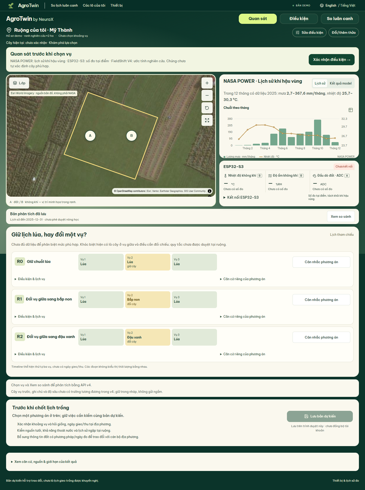

# AgroTwin · NeuraX

**NASA International Space Apps Challenge 2026 · Field Shift**

AgroTwin helps farmers explore crop rotation questions using NASA climate data, local agricultural references and explicit farm constraints. The dashboard compares three reference rotations, shows monthly climate estimates and their uncertainty, and answers supported questions with traceable citations. When evidence is missing, it asks for more information or abstains.

**[Open the live v4 demo](https://agrotwin-six.vercel.app/w/my-thanh/farmer)** · Hosted on Vercel Hobby. [Deployment notes](docs/DEPLOYMENT.md).



**Start here:** [7-slide presentation](presentation/ArgoTwin-Pitch.pdf) · [Editable HTML](presentation/slides/index.html) · [English pitch](presentation/07-FULL-PITCH-EN.md) · [Architecture](docs/ARCHITECTURE.md) · [Validation](docs/VALIDATION.md) · [Data sources](docs/DATA.md)

## Run the demo

Prerequisites: **Python 3.11–3.12**, **Node.js 22.22.2+ or 24.15+**, and npm. No API key, GPU, Ollama or paid service is needed. Internet is needed to install dependencies; map imagery and optional live data also use external services.

```powershell
git clone https://github.com/NeuraX-Lab/AgroTwin.git
cd AgroTwin
python -m venv .venv
.\.venv\Scripts\Activate.ps1
python -m pip install -r requirements.txt
python scripts/bootstrap.py --offline
cd frontend
npm ci
cd ..
python scripts/dev.py
```

On macOS/Linux use `python3 -m venv .venv` and `source .venv/bin/activate` for the environment, then use the same Python/npm commands. Open **http://127.0.0.1:5174/w/my-thanh/farmer**. Ctrl+C stops the processes started by this command.

For a public demo on the free Vercel Hobby plan, see [CLI deployment](docs/DEPLOYMENT.md). The hosted adapter runs the same frozen v4 and uses temporary request storage for A1/H1.

The offline bootstrap restores the exact small frozen resources included in the repository, including all six selected climatology artifacts. It does **not** train a model. External agricultural PDFs and web pages are excluded from Git. Without those files, their citations fail verification and the corresponding questions receive an insufficient-evidence response. NASA context questions remain available. To obtain the full source set:

```powershell
python scripts/bootstrap.py
```

This downloads publications from their original URLs and checks their original sizes and SHA-256 hashes. If a publisher changes a file, the installer refuses it. See [source acquisition and offline behavior](docs/REPRODUCIBILITY.md). Raw downloads stay ignored in `backend/data/raw/`.

If another demo uses the default ports, choose three unused ports:

```powershell
python scripts/dev.py --a1-port 18000 --v4-port 18184 --ui-port 15174
```

## What is implemented

| Component | Selected implementation |
|---|---|
| Climate data | Frozen NASA POWER monthly series, 514 months, January 1984–October 2026; one study coordinate |
| Climate model | Historical same-month mean, three variables × horizons 1 and 3 months; pooled empirical intervals |
| Evidence retrieval | 17 bilingual analyst-authored cards; BM25 + character TF-IDF hybrid search |
| Answer gate | Query support, policy checks and source-byte verification; cited extractive answer or refusal |
| Rotation comparison | R0/R1/R2 constraint checks using user-supplied conditions; no invented ranking or probability |
| Dashboard | React/TypeScript, Vietnamese/English, saved runs, source inspection, climate plots and map context |
| Optional hardware | Web Serial telemetry and the independent A1/H1 ingestion API; a physical device is not required |

**Research prototype:** NASA grid values are regional context, not measurements at a farm. The 17 cards are evidence summaries, not 17 official standards. The selected system remains **v4**; later experiments are not silently promoted. It does not establish crop suitability, yield gain, profit, water savings or calibrated success probabilities. See [limitations](docs/VALIDATION.md).

## Repository map

```text
frontend/       Integrated dashboard, assets and frontend tests
backend/        Selected v4 API, climate/RAG code, frozen resources and reports
a1/             Pinned geometry/data/history and optional H1 API source
scripts/        Portable bootstrap, local launcher and submission checks
docs/           Architecture, data, validation, provenance and demo instructions
presentation/   Exactly seven editable HTML slides, PDF and pitch scripts
```

This is a curated consolidation of the team's existing work. Source repositories, original commit IDs, authors and file hashes are recorded in [provenance](docs/PROVENANCE.md); the initial commit here is a packaging date, not the original creation date of every component. The presentation retains its existing **ArgoTwin** title and filenames.

## Verify

```powershell
python scripts/verify.py
python -m pytest -q backend/tests/test_selected_v4.py backend/tests/test_v4_dashboard_integration.py
python -m pytest -q a1/tests
cd frontend
npm test
npm run lint
npm run build
```

Additional source-integrity tests require the full source set: from `backend/`, run `python -m pytest -q tests/test_research_v3.py tests/test_research_v4.py`. See [recorded submission checks](docs/SUBMISSION-CHECKS.md) for the actual scope and results. Historical research results are retained separately from checks of this packaging.

## Team

Lê Nguyễn Gia Hưng · Huỳnh Quốc Việt · Nguyễn Thanh Hằng · Võ Thị Ngọc Bích · Nguyễn Hoàng Quang Luật.

## License and attribution

Original team code is available under the [MIT License](LICENSE). Third-party data, publications, dependencies, imagery and marks retain their own terms; see [THIRD_PARTY_NOTICES.md](THIRD_PARTY_NOTICES.md). NASA/Space Apps marks identify the challenge context and do not imply NASA endorsement. AI-assisted work is disclosed in [provenance](docs/PROVENANCE.md).
