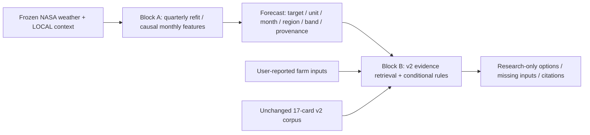

# V3 — causal validation and seasonal anomalies

Branch: `research/ai-v3-causal-validation`. Source: `c6fad2b` (v2 API fix), v2 implementation `173bbb8`, v1 `2e810c7`, original baseline `77b7197`. Version identity was checked against Git history and file contents; the UI V5 handoff is not an AI baseline.

ML and RAG stay separate. V3 only changes ML research/selection/calibration; v2 runtime is preserved. New runtime is added in v4. Weather targets remain precipitation, temperature and RH at horizons 1/3 months, single existing AOI. No new labels, sources, geography, commercial services or weight fine-tuning.

Hypothesis: train-only seasonal centering plus Ridge shrinkage might model anomalies with fewer degrees of freedom; 10/20-year climatology might track drift. Ablations: full-history mean/median, seasonal-naive, recency 10/20, anomaly alpha 20/200/2000, frozen v2 specification, fixed v1-style HGB reference. The reference uses v2 feature/regularization defaults and is **not** an exact v1 reproduction; exact historical v1 is audited separately. Candidate results and failures are all retained.

Result: no candidate passes the predeclared robustness gate. V3 selects mean climatology for all six tasks. This is a validation decision, not a claim that climatology has the smallest error in every period. Fitting seasonal-anomaly Ridge is training; alpha search is hyperparameter tuning; residual bands are calibration. No LLM or neural weights are trained.

Skills used: `neurax-model-research` (method/source review), `neurax-data-qa` (calendar, coverage, provenance and causal mutation tests), `neurax-model-gating` (baseline gate), `neurax-domain-evidence` (limits on field recommendation), `neurax-api-contract` (versioned integration). All are under `.agents/skills/<name>/SKILL.md`. Global catalog/content search found no additional forecasting skill needed; installer instructions were inspected, no external skill code installed. The skill's one-advanced-candidate guideline is expanded by the user's explicit multi-hypothesis research authorization.

Methods consulted 2026-11-15 Asia/Saigon: [scikit-learn 1.5 time splits](https://scikit-learn.org/1.5/modules/generated/sklearn.model_selection.TimeSeriesSplit.html), [Forecasting: Principles and Practice, time-series cross-validation](https://otexts.com/fpp3/toolbox.html#time-series-cross-validation), [Google Research: sufficient context](https://research.google/blog/deeper-insights-into-retrieval-augmented-generation-the-role-of-sufficient-context/). These support evaluation design, not empirical superiority on this dataset. No novelty claim.

No independent agronomic review by Bích/Quang Luật was performed. Their sign-off is still needed to support field application; research and deterministic technical checks proceed under the user's authorization.
