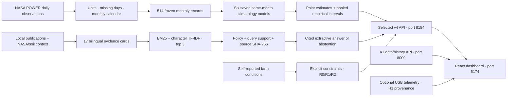

# Selected v4 architecture

The frontend proxies `/api/v4` to selected v4 and `/api` to A1. `scripts/dev.py` sets these targets for the chosen local ports. Each analysis invokes all six saved models and receives a fresh run ID, request hash and frozen artifact provenance. There is no fitting during an API request.

The six selected tasks are rainfall (`mm/month`), mean air temperature (`degC`) and relative humidity (`percent`), each at 1- and 3-month horizons. The selected point method is seasonal mean climatology. More complex candidates did not pass the development promotion gate. Uncertainty uses a pooled empirical residual radius; v5/v6 intervals are not enabled.

RAG retrieves evidence; it does not train an LLM. A v4 answer is an extract from an authored evidence card with its source locator and hash. Byte integrity establishes which source version was checked; it does not establish expert agronomic approval or semantic completeness.

Rotation constraints use supplied farm inputs. Forecast changes cannot manufacture crop eligibility. Missing inputs stay unknown; ranking, success probability and domain approval remain unset/false. A1/H1 handles a separate geometry/history/telemetry contract and does not automatically turn raw sensor readings into a crop score.

Implementation: [selected API](../backend/scripts/selected_v4_api.py), [model protocol](../backend/scripts/research_v3.py), [RAG gate](../backend/scripts/research_v4.py), [A1/H1](../a1/neurax/agrotwin/), [frontend v4 adapter](../frontend/src/features/dashboard/v4.ts).
