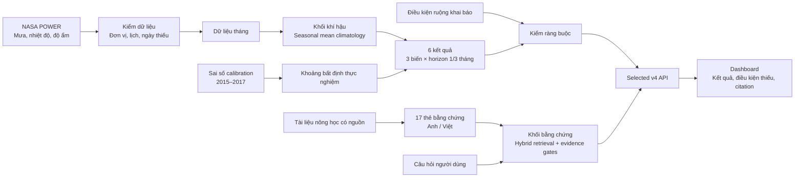
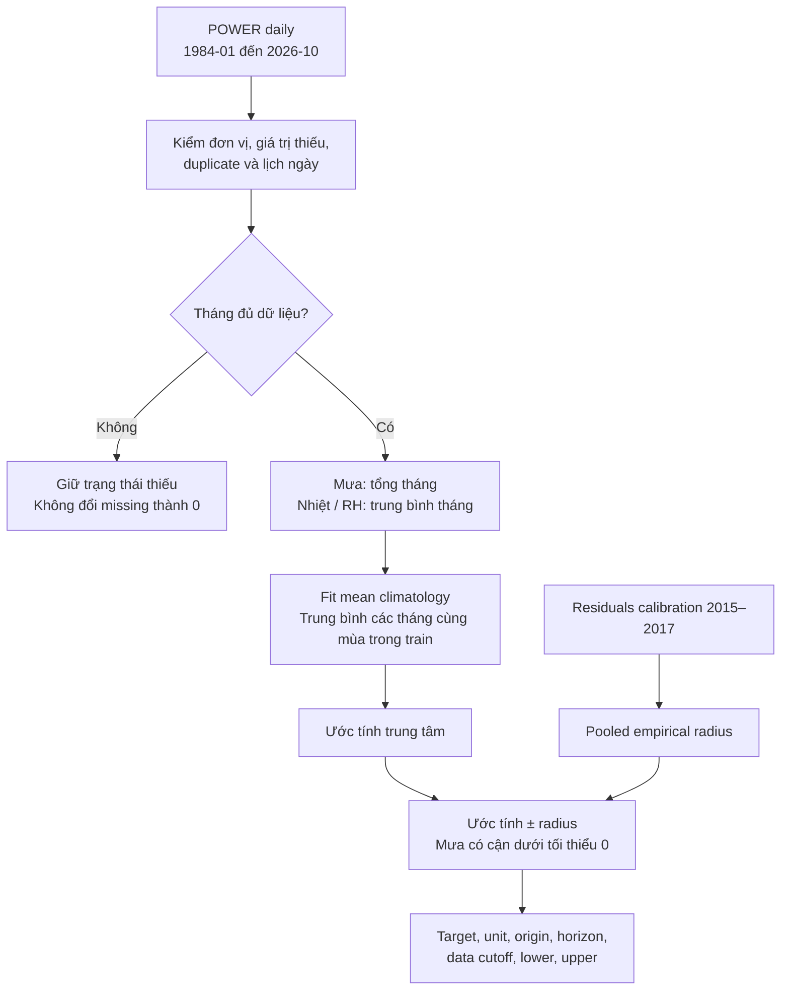
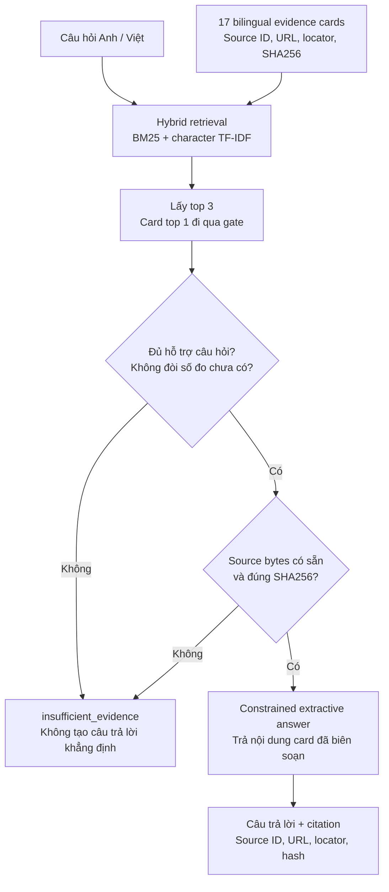
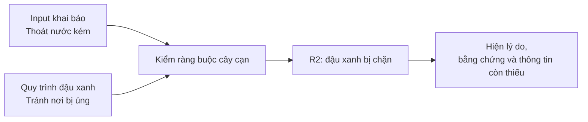
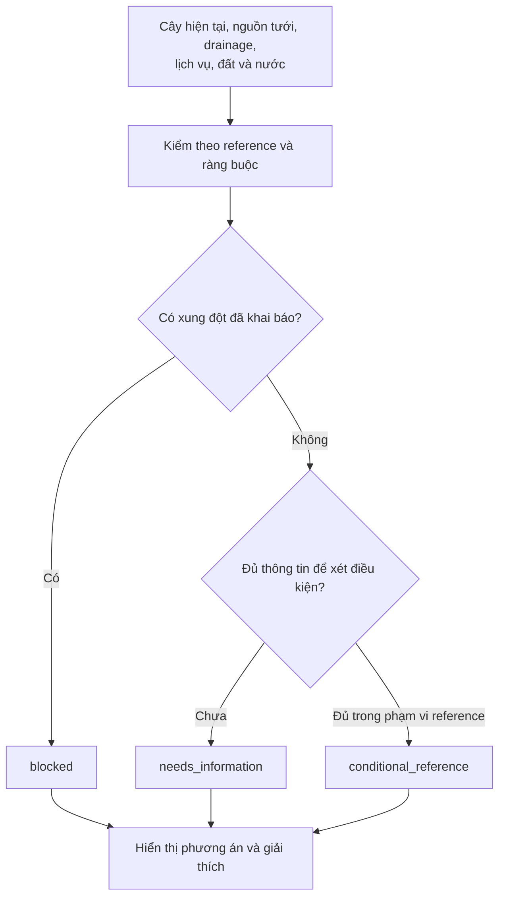
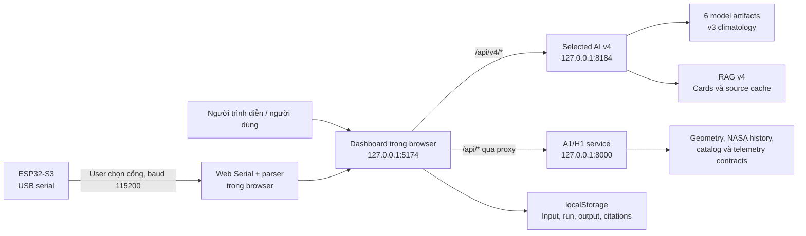
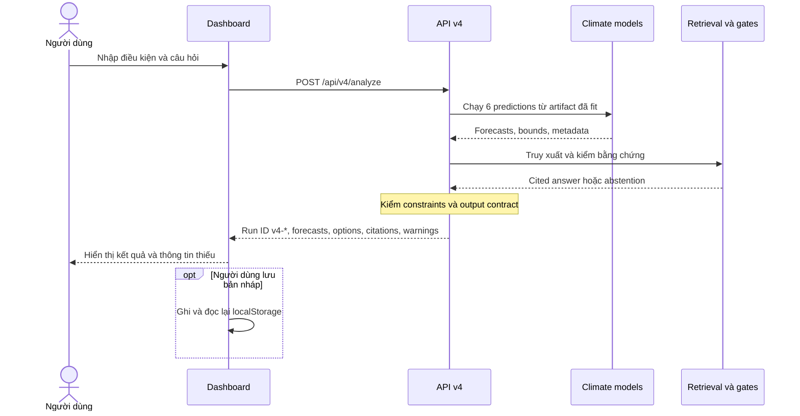

# ArgoTwin v4 — sơ đồ kiến trúc

Bản kiến trúc phục vụ trình bày và demo, đối chiếu ngày 15/11/2026. **Selected v4 = ML v3 seasonal climatology + RAG v4 refined evidence gate + pooled empirical intervals.** Dashboard v4 đã có bản tích hợp local; các ghi chú cũ “chưa nhận UI” không còn mô tả bản đang chạy.

Mở file bằng trình xem Markdown hỗ trợ **Mermaid** như GitHub hoặc Markdown Preview có Mermaid. Các sơ đồ là cấu trúc logic, không ngụ ý hệ thống đã được kiểm chứng canh tác tại ruộng.

## 1. Tổng thể DATA → AI → UI

**Câu giải thích:** Dữ liệu NASA cung cấp bối cảnh khí hậu; tài liệu địa phương cung cấp bằng chứng; điều kiện ruộng giúp kiểm xung đột trước khi hiển thị kết quả.

## 2. DATA và phương pháp khí hậu

- Đây là baseline thống kê đã fit, không phải neural network.
- Ba target: mưa tháng, nhiệt độ trung bình, độ ẩm không khí trung bình; mỗi target có horizon 1 và 3 tháng.
- Snapshot đến 10/2026: origin 11/2026, tháng đích 12/2026 và 02/2027 do availability buffer. Đây không phải dự báo từng ngày.
- Ví dụ mưa tháng 12/2026: **33,68 mm**, khoảng thực nghiệm **0–93,27 mm**. Radius khoảng 59,59 mm; cận âm được chặn ở 0.
- Nominal coverage 80% là mục tiêu; coverage mưa trên diagnostic lịch sử đạt khoảng 67,7%. Diagnostic đã được dùng trước đó, không phải blind test độc lập; không có bảo đảm coverage cho từng dự báo.

## 3. RAG — từ câu hỏi tới câu trả lời có nguồn

**Hybrid search chỉ là bước truy xuất**, chưa phải toàn bộ RAG. Sau đó còn kiểm mức hỗ trợ, kiểm nguồn và ghép câu trả lời có trích dẫn hoặc từ chối. Bản này không fine-tune LLM và không dùng LLM tự tạo số liệu nông học. Hash xác nhận file đúng bản đã pin, không tự chứng minh diễn giải nông học đúng.

## 4. Quyết định luân canh và ví dụ demo

R0/R1/R2 lần lượt là lúa–lúa–lúa, lúa–bắp non–lúa, lúa–đậu xanh–lúa. Các trạng thái trên là output prototype; rank, score và success probability vẫn null, domain approval chưa có. Không suy ra cây tốt nhất hoặc mức tăng năng suất.

## 5. Dashboard, hai dịch vụ backend và ESP32

Hai backend có vai trò khác nhau: A1/H1 giữ context và hợp đồng telemetry; selected v4 xử lý inference và evidence. Luồng demo v4 không cần dịch vụ v2. Các cổng đều bind local.

Số đo ESP32 được hiển thị riêng: nhiệt độ, %RH, raw soil ADC và thời điểm nhận. Raw ADC không tự thành phần trăm ẩm đất đã hiệu chuẩn; dữ liệu bench/thiếu device time không được mặc định đủ điều kiện đưa vào AI. Không có đường nối trực tiếp từ sensor sang crop score trong sơ đồ này.

## 6. Một lần bấm phân tích v4

Mỗi request phân tích chạy inference từ model hiện có, **không train lại model**. Mở bản nháp đã lưu không tự gọi phân tích mới. Run ID của request khác selection ID `research-*` của bộ artifact.

## Nguồn đối chiếu

- `neurax-docs/nasa-space-apps-2026/selected-system-v4/01-AI-ARCHITECTURE.md`: ML, RAG, constraints và uncertainty; ghi chú UI pending trong tài liệu cũ đã được thay bằng trạng thái tích hợp local ở sơ đồ trên.
- `neurax-fieldshift-lab/integration/README-v4.md`: cập nhật dashboard integration, fresh inference, service identity và contract.
- `work/agrotwin-v4-integration/docs/integration/V4_ESP32_INTEGRATION_REPORT.md`: A1/H1, backend v4, persistence và hardware gates.
- `work/agrotwin-v4-integration/frontend/vite.config.ts`: proxy thực tế giữa 5174, 8184 và 8000.
- `neurax-fieldshift-lab/reports/v3/evidence/bands-frozen.json` và API forecast đã lưu: radius, calibration và ví dụ khoảng mưa.

Giới hạn còn lại: một AOI chưa survey độc lập, coarse climate grid, historical diagnostic đã lộ, uncertainty chưa được bảo đảm, chưa có agronomic sign-off hoặc farmer trial trong bằng chứng dùng ở đây.
