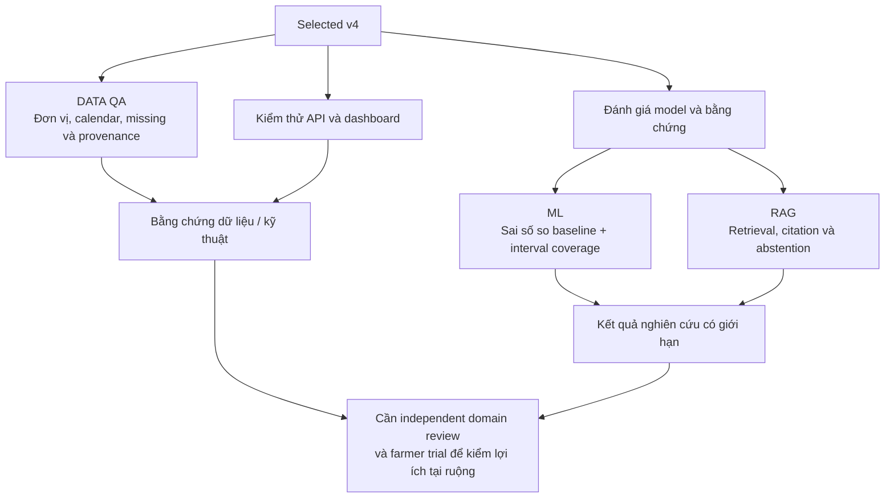
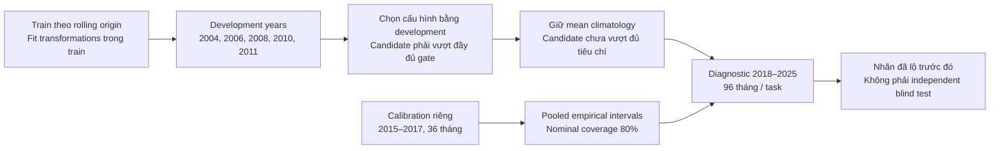
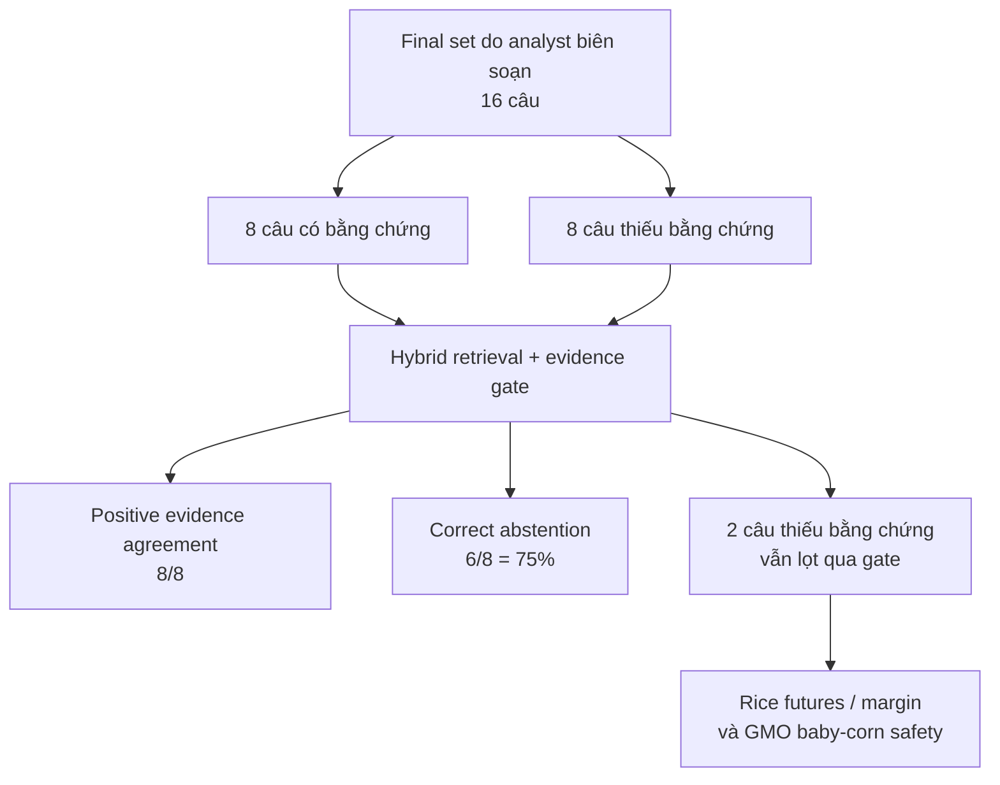
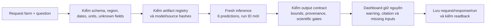

# ArgoTwin v4 — validation và sơ đồ kiểm chứng

Selected v4 gồm ML v3 seasonal mean climatology, RAG v4 refined evidence gate và pooled empirical intervals. Các kết quả dưới đây được đối chiếu từ báo cáo/artifact đã có; không phải một lần chạy lại toàn bộ đánh giá hôm nay.

## 1. Ba lớp kiểm chứng

Test phần mềm đạt không đồng nghĩa mô hình đúng ngoài thực tế. Trích dẫn đúng file không tự chứng minh câu trả lời đúng ý câu hỏi.

## 2. ML — cách chia thời gian

Development gate: MAE giảm ít nhất 3%, thắng ít nhất 3/5 năm, không mùa nào kém hơn 10%, lower bound của paired year-block CI95 lớn hơn 0. Các gate này có giới hạn do mẫu nhỏ và quá trình lựa chọn.

### Kết quả khí hậu

| Target / horizon | V4 MAE | Frozen v2 MAE cùng protocol | V4 interval coverage |
|---|---:|---:|---:|
| Rain h1, mm/tháng | 62,7357 | 66,2414 | 67,71% |
| Rain h3, mm/tháng | 62,7357 | 62,1183 | 67,71% |
| Temperature h1, °C | 0,5373 | 0,5435 | 85,42% |
| Temperature h3, °C | 0,5373 | 0,5376 | 85,42% |
| RH h1, điểm phần trăm | 3,6331 | 2,9983 | 82,29% |
| RH h3, điểm phần trăm | 3,6331 | 3,2034 | 82,29% |

**Diễn giải:** MAE thấp hơn tốt hơn. Đối chứng là giá trị tháng POWER, chưa phải số đo ruộng. Tỷ số MAE trung bình ngang trọng số sáu task so với frozen v2 là 1,04851: v4 kém khoảng 4,85% trên diagnostic này. Không khẳng định ML v4 thắng toàn diện.

Mưa có bias khoảng −49,64 mm/tháng; MAE mùa ướt h1 khoảng 90,706 mm, mùa khô 23,578 mm. Nominal 80% chưa đạt ở mưa; `coverage_guaranteed=false`. Có caveat timing ở cuối calibration 2017 với origin đầu 2018 và chưa xác minh historical release vintages.

## 3. RAG — answerable và unanswerable

| Chỉ số final | Kết quả | Phạm vi |
|---|---|---|
| Positive evidence agreement | 8/8 | Khớp evidence ID kỳ vọng |
| Retrieval recall@3 | 100% | Trên 8 câu positive |
| Correct abstention v4 | 6/8, 75% | Trên 8 câu negative |
| Correct abstention v2 | 1/8, 12,5% | Cùng final set |
| Byte-verified citation share | 100% | Các câu trả lời được dẫn nguồn |
| Expert semantic groundedness | Chưa đánh giá | Không có expert gold |

Development có 19 câu, gồm 11 positive và 8 negative; final tách development nhưng là bộ nhỏ do analyst biên soạn. Không suy 8/8 hoặc citation 100% thành accuracy tổng quát. Card có thể đúng nguồn mà không trả lời đúng câu hỏi.

## 4. Integrity và kiểm thử tích hợp

- Receipt tích hợp backend mới ghi **86 tests passed**, gồm kiểm hai request tạo hai run ID và tổng 12 predict calls, registry corruption, input/CORS/error handling và output gates. Đây là số của báo cáo tích hợp, không phải 86 phép kiểm khoa học độc lập.
- Receipt selected API trước đó ghi 82 tests; hai con số thuộc các mốc khác nhau.
- Integration identity: `selected_system=v4`, `api_schema_version=fieldshift-dashboard-1`, sáu model, source cache ready/partial. Không dùng inner schema lịch sử `fieldshift-2` để kết luận provider là v2.
- Không fallback sang output v2 khi v4 lỗi. Inference không phải training lại. Mở draft đã lưu không tự chạy request mới.
- ESP32 bench, Web Serial hoặc replay cần nhãn riêng. Chưa có kết nối sensor không làm cho DATA/ML/RAG được xác nhận tại ruộng.

## 5. Những gì validation chưa chứng minh

Chưa có independent agronomic sign-off, đánh giá generalization nhiều vùng, ground truth tại ruộng cho forecast, hoặc thử nghiệm nông dân để đo năng suất, lợi nhuận và tiết kiệm nước. Rank/score/success probability của rotation vẫn null; domain approval chưa có.

## Câu trình bày ngắn

**English:** “We evaluated climate estimates against POWER data and tested evidence retrieval and refusal. The rainfall diagnostic MAE was 62.74 millimetres per month. In our small RAG final set, six of eight unsupported questions were declined. These are research results; field benefits still require validation.”

**Tiếng Việt:** “Chúng tôi đánh giá ước tính khí hậu bằng dữ liệu POWER và kiểm khả năng truy xuất, từ chối của hệ thống bằng chứng. MAE mưa trên diagnostic là 62,74 milimét mỗi tháng. Trong bộ final RAG nhỏ, hệ thống từ chối đúng sáu trên tám câu thiếu bằng chứng. Đây là kết quả nghiên cứu; lợi ích tại ruộng vẫn cần kiểm chứng.”

## Nguồn đối chiếu trong workspace

- `neurax-docs/nasa-space-apps-2026/selected-system-v4/02-ML-VALIDATION.md`
- `neurax-docs/nasa-space-apps-2026/selected-system-v4/03-RAG-EVIDENCE.md`
- `neurax-fieldshift-lab/reports/v3/evidence/final-diagnostic.json`
- `neurax-fieldshift-lab/reports/v3/evidence/bands-frozen.json`
- `neurax-fieldshift-lab/reports/v4/evidence/refined/final.json`
- `neurax-fieldshift-lab/integration/README-v4.md`
- `work/agrotwin-v4-integration/docs/integration/V4_ESP32_INTEGRATION_REPORT.md`

Sơ đồ dùng Mermaid; mở bằng GitHub hoặc Markdown Preview hỗ trợ Mermaid để render.
